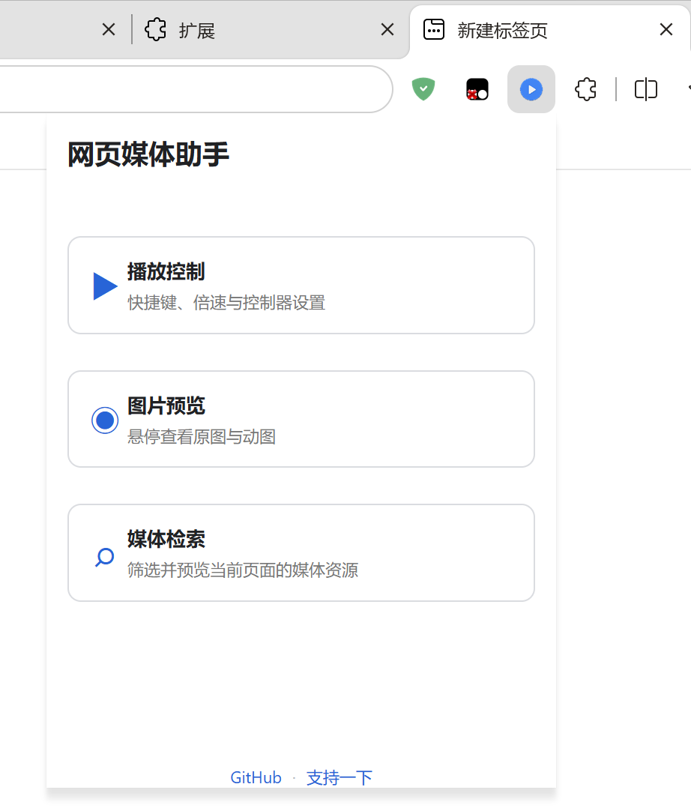

# 网页媒体助手

[English](README_en.md)

[隐私政策](PRIVACY.md)

一个 Microsoft Edge 网页媒体工具箱，三个功能可独立启用：

- 播放控制：倍速、进度快捷键和页面控制器。
- 图片预览：悬停查看原图或动图，可编辑和导入导出预览规则。
- 媒体检索：查找、预览和下载当前页面加载的媒体资源。

图片预览基于 Imagus 0.9.8.74，随扩展内置默认设置和 314 条站点解析规则。为避免公开上游共享 API 凭据，未包含 Flickr、Tumblr、Twitch Clips 和 Naver TV 的旧规则。当前版本只处理图片，不提供视频预览。

## 预览

| 扩展首页 | 播放控制 | 图片预览 | 媒体检索 |
| --- | --- | --- | --- |
|  |  |  |  |

## 许可

本项目原创的整合代码、设置界面和 UI 设计采用 MIT License。第三方代码仍使用各自许可，详见 [LICENSE](LICENSE) 和 [THIRD_PARTY_NOTICES.md](THIRD_PARTY_NOTICES.md)。Imagus 相关文件不在 MIT 授权范围内。
